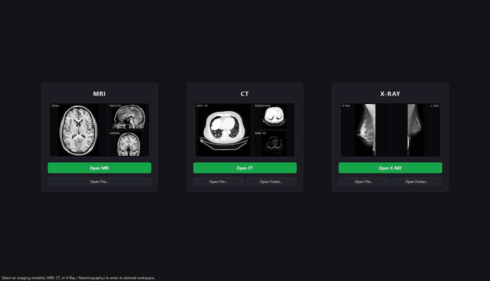
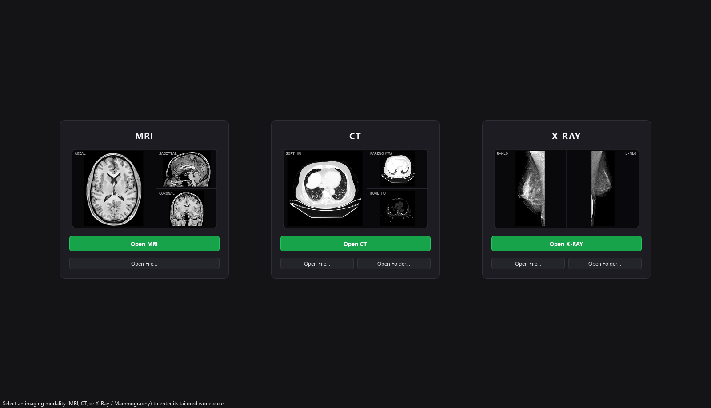
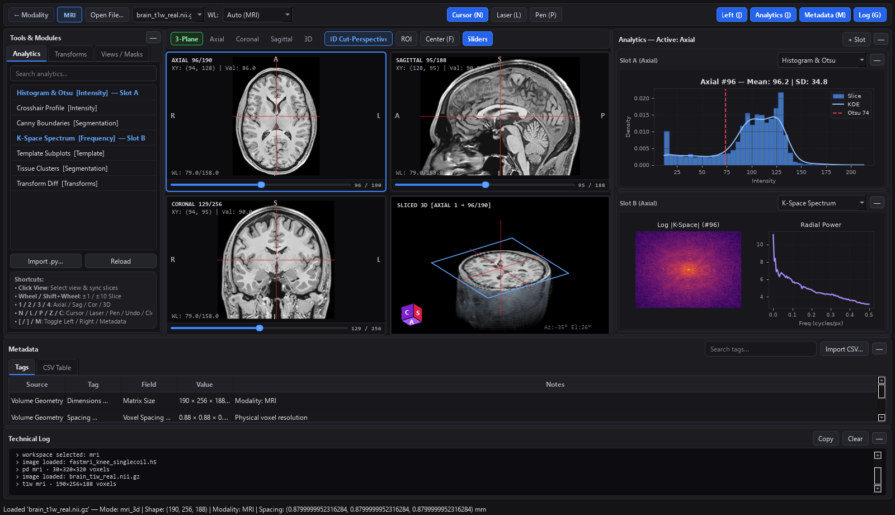
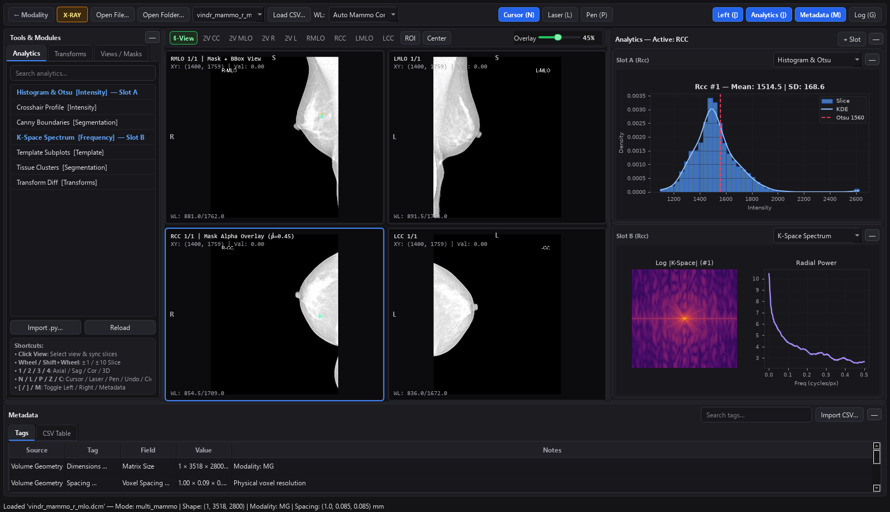
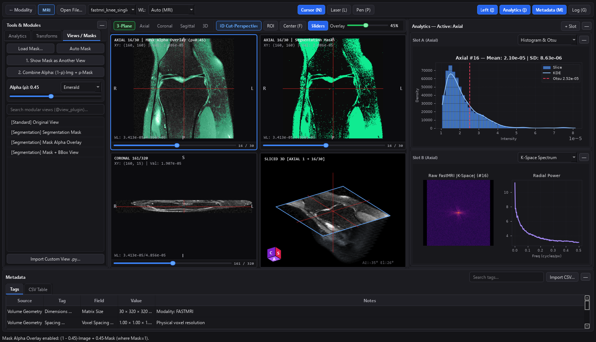

<div align="center">


# MIAV

**Medical Imaging, Analysis & Visualization**



</div>

**Medical image visualization with real time analytics, transforms from python and a 3D volume renderer.**

Works with:
- nifti
- dicom
- hdf5

You can add:
- own analytics (matplotlib, scikit-image, etc.)
- metadata csv
- own image transforms (albumentations, opencv, scipy, etc.)
- own modular views & segmentation mask overlays (`@view_plugin`)

Need to write your own analytics, transforms, and views **in python** :'(, refer to examples in `plugins/analytics`, `plugins/transforms`, and `plugins/views` and **[writing custom plugins below](#writing-custom-python-analytics-transform--view-plugins)**. You can also use the built-in views, transforms, and analytics.

---

## UI Overview

### 1. Modality Selection Launcher (`MRI`, `CT`, `X-RAY`)


### 2. 3D MRI Workspace (`3-Plane MPR + 3D Cut-Perspective & Terminal Log`)


### 3. X-Ray (Mammo) Workspace (`4-View Screening: RMLO, LMLO, RCC, LCC`)


### 4. Segmentation Mask Views & Top-Bar Alpha Blending (`(1 - ρ)·Image + ρ·Mask`)


---

Below is some ai text to help you get it working. Hopefully it will be easier to understand than my explanation of it.

## Key Features

- **Modality-Tailored Workspaces (`MRI`, `CT`, `X-RAY`)**:
  - Launch directly into a dedicated workspace for **MRI**, **CT (Hounsfield Units)**, or **X-Ray (Digital Mammography)** from realistic clinical preview cards, removing unrelated toolbar and viewport clutter.
  - **Top Viewport Bar**: Switch cleanly between **`3-Plane`**, **`Axial`**, **`Coronal`**, **`Sagittal`**, and **`3D`** in 3D MRI/CT mode, or **`4-View`**, **`2V CC`** (`RCC` | `LCC`), **`2V MLO`** (`RMLO` | `LMLO`), **`2V R`** (`RMLO` | `RCC`), **`2V L`** (`LMLO` | `LCC`), and single views (**`RMLO`**, **`RCC`**, **`LMLO`**, **`LCC`**) in 2D X-Ray/Mammo mode (with 3D red crosshair lines hidden on 2D radiographs). Also includes **`3D Cut-Perspective`**, **`ROI`**, **`Center`** (`F`), **`Sliders`**, and the dynamic **`Overlay`** alpha slider.
- **3D Volume Viewer (`3D Cut-Perspective`, Surface-Shaded `Whole Volume`, `Ortho Slices` & Orientation Cube)**:
  - **`3D Cut-Perspective` (`Sliced Volume`)**: Dynamically cuts the 3D brain/organ volume open along whichever 2D view (`Axial`, `Sagittal`, or `Coronal`) is currently selected for analytics, with a live **`(C)oronal` / `(S)agittal` / `(A)xial`** orientation cube in the corner.
  - **`Whole Volume`**: 3D volumetric raycaster with 3D gradient surface normals, Phong/Lambertian lighting, and ray-jitter dithering (`Translucent`, `MIP`, `CT Bone`).
  - **`Ortho Slices`**: 3D intersecting orthogonal slice planes.
- **Segmentation Masks & Modular Views (`@view_plugin`)**:
  - **Show as Another View**: Display the standalone `Segmentation Mask` in a companion viewport synchronized to the active slice.
  - **Top-Bar Alpha Overlay (`(1 - ρ)·Image + ρ·Mask`)**: Combines the original slice and segmentation mask strictly where `mask == 1` (`mask > 0`), controlled by a live top-bar `Overlay` slider (`0%` – `100%`) and color selector (`Emerald`, `Red`, `Cyan`, `Yellow`, `Grayscale`).
  - **Modular Python Views**: Write custom `@view_plugin` scripts in Python to visualize custom dataset overlays, masks, contours, or bounding boxes.
- **Real-Time Drag-and-Drop Python Analytics (`@analytics_plugin`) & 2D ROI Subpart Analysis**:
  - Drag any Python analytics module from the left sidebar and drop it onto **Analytics Slot A, B, or C**.
  - Toggle **`ROI`** in the top viewport bar and drag a rectangle on any 2D slice to focus analytics (histograms, Otsu/multi-Otsu tissue segmentation, Canny/Frangi vesselness, etc.) on that exact 2D ROI subpart.
- **Live Albumentations & Image Transform Pipeline (`@transform_plugin`)**:
  - Stack and tune deterministic **Albumentations**, **OpenCV**, **SciPy**, and **MRI Artifact** transformations (`CLAHE`, `Gamma`, `Brightness/Contrast`, `Equalize`, `Posterize/Invert`, `Zoom`, `Rotate`, `Flip/Transpose`, `Elastic Deformation`, `Gaussian/Median Blur`, `Sharpen/Unsharp Mask`, `Emboss`, `Gaussian/Rician Noise`, `MRI RF Bias Field`, `K-Space Gibbs Ringing`) with auto-generated interactive sliders and alpha blending.
- **Presentation & Ephemeral Annotation Modes**:
  - **Laser Pointer Trail (`L`)**: Clicking and dragging draws a glowing red cursor trail that persists briefly and smoothly fades out over `~1.35 seconds`.
  - **Persistent Pen (`P`)**: Draws Freehand, Line, or Rectangle annotations that remain across slice scrolling (**Screen-Pinned** by default, or toggle **Pin**), with contextual Pen tools that appear only when Pen mode is active.
- **Polars Metadata Inspector & Terminal Technical Log (`G`)**:
  - Real-time search and filtering over DICOM tags, NIfTI headers, FastMRI XML attributes, and clinical `.csv` cohorts powered by `polars`, paired with a collapsible terminal-style **Technical Log** (`> image loaded: ...`) at the bottom.

---

## Quick Start (Windows 11 & Ubuntu Linux)

### 1. Install Dependencies
```bash
pip install -r requirements.txt
```
*(Supports `PySide6`, `PyQt6`, or `PyQt5` automatically via [`miav/ui/qt_compat.py`](miav/ui/qt_compat.py)).*

### 2. Download Real Clinical Sample Datasets
```bash
python generate_sample_data.py
```
Downloads real clinical datasets into `./sample_data/` (and loads them automatically on launch):
- `sample_data/fastmri_knee_singlecoil.h5` (Real NYU fastMRI Single-Coil Knee MRI with complex `kspace` & `reconstruction_rss`)
- `sample_data/vindr_mammo_r_cc.dcm` & `sample_data/vindr_mammo_r_mlo.dcm` + `sample_data/vindr_mammo_annotations.csv` (Real VinDr-Mammo Right CC & MLO Digital Mammography DICOMs with BI-RADS 4 Mass)
- `sample_data/brain_t1w_real.nii.gz` (Real 3D Human Brain T1w MRI NIfTI)
- `sample_data/real_ct_dicom_series/` (44-slice Real 3D Clinical CT DICOM series in Hounsfield Units)

### 3. Launch the Workstation
```bash
python main.py
# Or open a specific file / DICOM directory directly:
python main.py sample_data/fastmri_knee_singlecoil.h5
```

### 4. Run the Modular Test Suites
```bash
python tests/test_miav.py
# Or run individual logical test suites:
python tests/test_loaders_and_models.py
python tests/test_plugins_and_transforms.py
python tests/test_viewport_and_navigation.py
python tests/test_workspaces_and_ui.py
```

---

## Keyboard & Mouse Shortcuts

| Shortcut / Action | Description |
| :--- | :--- |
| `Left-Click on Slice` | Selects view for analytics (blue border) and syncs the other 2 orthogonal slices to that 3D point (clicking in black letterbox margins selects the view without moving the crosshair) |
| `Mouse Wheel (2D View)` | Scroll `+1 / -1` slice in the **hovered** 2D viewport (and syncs crosshairs on the other views) |
| `Mouse Wheel (3D View)` | Zoom in / out in the 3D volume viewport |
| `Shift + Mouse Wheel` | Fast scroll `+10 / -10` slices in the hovered 2D viewport |
| `Arrow Keys (Up/Down/Left/Right)` | Move the 3D crosshair on the **selected** 2D viewport (updating orthogonal slices) |
| `1`, `2`, `3`, `4` | Select **Axial (`1`)**, **Sagittal (`2`)**, **Coronal (`3`)**, or switch to **3D View (`4`)** |
| `Space` | Cycle view tabs (`3-Plane` $\leftrightarrow$ `Axial` $\leftrightarrow$ `Coronal` $\leftrightarrow$ `Sagittal` $\leftrightarrow$ `3D`) |
| `N` or `Esc` | Activate **Cursor** mode (crosshair navigation) |
| `L` | Activate **Laser** mode (fading red presentation trail) |
| `P` | Activate **Pen** mode (shows **Freehand**, **Line**, **Rectangle**, **Pin**, **Undo**, and **Clear** controls) |
| `Z` or `Ctrl + Z` | **Undo** the last drawn Pen annotation |
| `C` | Clear all persistent pen drawings |
| `O` | Toggle **Mask Alpha Overlay** (`(1 - ρ)·Image + ρ·Mask` where `Mask = 1`) on active viewport |
| `[` / `]` / `M` / `G` | Toggle **Left Panel (`[`)**, **Right Analytics Panel (`]`)**, **Metadata (`M`)**, or **Technical Log (`G`)** |
| `R` | Reset Window/Level, zoom/pan, and 3D camera |
| `Right-Click + Drag` | Adjust **Window Width** (horizontal) and **Window Level** (vertical) |
| `Ctrl + Mouse Wheel` | Zoom in / out anchored at the current mouse cursor position |
| `Ctrl + Left-Click + Drag` | Pan / move the zoomed image without changing the crosshair or active view |
| `F`, `Home`, or `Ctrl + 0` | **Center** zoomed/panned image back into the viewport (without resetting Window/Level) |
| `Middle-Click + Drag` | Pan slice |

---

## Writing Custom Python Analytics, Transform & View Plugins

Drop any `.py` script into `plugins/analytics/`, `plugins/transforms/`, or `plugins/views/` (or load it at runtime via **Import .py...** in the sidebar).

### 1. Custom Analytics Plugin (`@analytics_plugin`)
```python
import numpy as np
from miav.plugin_sdk import analytics_plugin, AnalysisContext

@analytics_plugin(
    name="My Custom Slice Histogram",
    category="Custom Analytics",
    description="Plots real-time intensity histogram of the active slice.",
)
def my_custom_histogram(ctx: AnalysisContext, fig):
    fig.clear()
    ax = fig.add_subplot(111, facecolor="#0f172a")
    ax.hist(ctx.image_2d.ravel(), bins=50, color="#38bdf8")
    ax.set_title(f"{ctx.plane.title()} Slice #{ctx.slice_idx}", color="white")
```

### 2. Custom Image Transform Plugin (`@transform_plugin`)
```python
import albumentations as A
import numpy as np
from miav.plugin_sdk import transform_plugin, Param
from miav.core.transform_pipeline import normalize_to_uint8, restore_from_uint8

@transform_plugin(
    name="Custom Albumentations Solarize",
    category="Custom Transform",
    params={
        "threshold": Param(128, min=10, max=245, step=5, label="Solarize Threshold", kind="int"),
        "alpha": Param(1.0, min=0.0, max=1.0, step=0.05, label="Alpha Blend"),
    },
)
def my_solarize(image: np.ndarray, threshold: int = 128, alpha: float = 1.0) -> np.ndarray:
    u8, vmin, vmax = normalize_to_uint8(image)
    aug = A.Solarize(threshold=(int(threshold), int(threshold)), p=1.0)
    out = restore_from_uint8(aug(image=u8)["image"], vmin, vmax)
    return (1.0 - alpha) * image + alpha * out
```

### 3. Custom Modular View / Segmentation Overlay Plugin (`@view_plugin`)
```python
import numpy as np
from miav.plugin_sdk import ViewContext, view_plugin

@view_plugin(
    name="Custom Dataset Mask Blend",
    category="Custom View",
    description="Blends (1 - rho) * image + rho * mask only where mask == 1.",
)
def my_custom_view(ctx: ViewContext) -> np.ndarray:
    # Return either a 2D float32 array (H, W) or an RGB uint8 array (H, W, 3)
    mask = (ctx.mask_2d > 0.5) if ctx.mask_2d is not None else np.zeros_like(ctx.image_2d, dtype=bool)
    return np.where(
        mask,
        (1.0 - ctx.rho) * ctx.image_2d + ctx.rho * float(ctx.image_2d.max()),
        ctx.image_2d,
    ).astype(np.float32)
```
